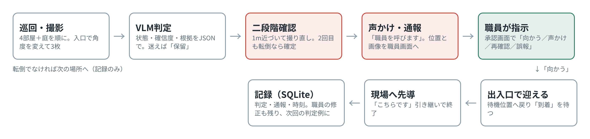
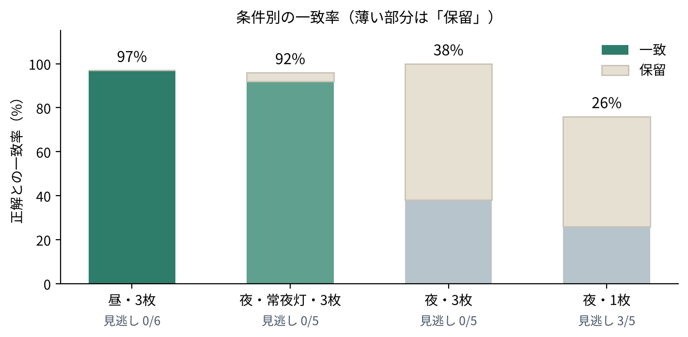

# 最終課題レポート：転倒時の初動対応ロボット

提出日：2026年10月30日　／　氏名：Kazuki Kobayashi

Physical AI 応用1 最終課題「AI×ロボティクスによる創造的タスクの実現」。課題名：倒れた人を見つけて、職員を連れてくるロボット（介護施設の居室と庭を巡回する転倒初動対応ロボット）。

## 1. 概要

介護施設の居室4部屋と庭を巡回する移動ロボット（TurtleBot3）が、カメラ画像を視覚言語モデル（VLM：Claude Sonnet 5.5、推論のみ）に渡して利用者の状態を判定し、転倒を見つけたら近づいて確かめ、声をかけ、職員に通報し、職員を出入口で迎えて現場まで先導するシステムを、ROS 2 Humble＋Gazebo上に実装した。

主な結果（30巡回、127判定）：

- 屋内・昼の状態判定の一致率は97%。常夜灯のある夜でも92%。消灯した夜は38%まで落ちるが、外れの大半は「判定保留」で、転倒の見逃しはない
- 転倒検知から、近づいて確認し通報するまでの中央値は14秒。誤報・誤った駆けつけは0件
- 庭（屋外）でも一致率90%、転倒は5件すべて検知・確定

評価の正解はシナリオ定義から自動で照合し、手では数えていない。VLMの呼び出しは149回、費用は約$0.73。

## 2. 目的と背景

本課題は、AIロボティクスに関する関係府省連絡会議『各分野別のAIロボティクス実装ロードマップ（別紛2）』（令和8年3月26日、8月28日一部変更）の介護分野（P38–39）を起点にした。同資料は2040年に介護人材が57万人不足するとし、必要技術として「在室中・睡眠中等の利用者の状態把握」「画像・センサーによる異常検知・判断」「暗所・逆光に強い画像認識」「介護特化のVLM開発」を挙げている。一方で、異常を見つけたあとにロボットが何をすべきかは書かれていない。

「記録」ではなく「初動対応」を選んだ理由：当初は巡回ロボットによる介護記録の自動生成を計画したが、「見回って記録する」だけなら固定カメラでもでき、ロボットである必然性が弱い。ロボットにしかできないのは、見つけたあとに**動いて助ける**ことである。そこで「転倒を見つけて、確かめて、声をかけ、通報し、職員を現場まで連れてくる」をタスクにした。

庭を含めた理由：居室にはナースコールや見守りセンサがあるが、庭や廊下には何もない。屋外（段差・砂利・芝生）は転倒の典型で、倒れても誰も気づかない。巡回ロボットの価値が最もはっきり出る場所である。

ロードマップの技術課題との対応：a ロバスト認識・状況理解、b ティーチングレス動作生成・知能制御、c 人等混在環境での安全制御、h システム連携。各工夫との対応は8章に示す。

## 3. 仮説

| 仮説 | 内容 | 指標 |
| --- | --- | --- |
| H1 状態判定 | 巡回画像を汎用VLMに渡し、閉じたラベル集合（臥床・立位・不在・転倒疑い・保留 など）で判定させれば、正解との一致率は実用の目安（90%）に届く | 一致率、混同行列 |
| H2 暗所 | 夜は単枚の判定が落ちるが、角度を変えた3枚を統合して判定すれば回復する。さらに常夜灯があれば昼に近づく | 条件別の一致率、保留率、転倒の見逃し |
| H3 初動対応 | 転倒疑いに対して「近づいて撮り直す」二段階確認を入れれば、誤った駆けつけを抑えつつ、検知から通報・先導までを短時間で完了できる | 確定率、誤報数、検知→通報・先導の秒数 |

いずれも学習は行わず、汎用VLMを推論のみで使う。「介護特化のVLM」を作らずに、プロンプトで判定規則を与えるだけでどこまで届くかを確かめる。

## 4. システム構成と実装

*図1　処理の流れ。転倒疑いは二段階確認を経て通報し、職員の指示で先導する*

ロボットは安価な移動体とカメラだけで、賢さは判定（VLM）と記録（DB）の側に置き、最終判断は職員が行う。この役割分担が設計の核である。

| 要素 | 実装 |
| --- | --- |
| ワールド | Gazebo。廊下1本（長さ12m）に4m四方の居室4部屋（ベッド・サイドテーブル・ナースコール・窓・手すり・椅子）、東端の出入口の先に庭（芝生・小道・縁石・ベンチ・花壇・木・外灯）。人物はGazebo公開モデル person\_standing を姿勢を変えて配置。ワールドはPythonで生成し、各場所の状態と照明（昼／夜／夜＋常夜灯）を引数で切り替える |
| ロボット | TurtleBot3 waffle\_pi（カメラ・LiDAR付き）。ROS 2 Humble |
| 巡回制御 | 自作のウェイポイント追従（オドメトリで位置、比例制御で向きと速度）。LiDARで前方0.3m以内に障害物があれば停止。Navigation2は使わず、入口で向きを変えて部屋に0.6m入って撮影する単純な方式 |
| 撮影 | 各場所でヨー角を −15°/0°/+15°（庭は±25°）に振って3枚。長辺640pxに縮小して1回の呼び出しにまとめて渡す |
| VLM | Claude Sonnet 5.5（API、推論のみ）。システムプロンプトでラベル集合と判定規則（「ベッドの外の床や小道に横たわっている→転倒疑い」「暗くて輪郭が取れない→保留」「迷ったら安全側」）を与え、状態・確信度・根拠文・人の有無をJSONで返させる。JSONが壊れていれば1回だけ言い直しを頼み、確信度0.6未満は「保留」に落とす（転倒疑いだけは閾値に関わらず残す）。呼び出しは1ファイルに閉じ込め、別社のAPIに差し替えられる |
| 二段階確認 | 1回目が転倒疑いなら1m近づいて撮り直し、2回目も転倒疑いのときだけ確定して通報する。否定されたら「要確認」として記録し巡回を続ける |
| 声かけ・通報 | 発話テキストを `/care/speech` に出し（シミュレーションでは画面表示）、通報を `/care/alert` とDBに出す |
| 職員の承認画面 | FlaskのWeb画面。通報に「向かう／声かけ／近づいて再確認／誤報」を指示し、出入口に「到着」を伝える。記録の下書きを承認・修正でき、修正は次回の判定例としてプロンプトに添えられる（学習なしのデータ還流。仕組みは実装、効果の計測は未） |
| 先導 | 指示を受けたら待機位置（出入口）へ戻って職員を待ち、到着後に現場まで先導して引き継ぐ |
| 記録 | SQLite。巡回（runs）、判定（records）、正解との照合（evals）、通報（alerts）、初動対応の時刻（incidents）、発話（speech）、職員の修正（corrections） |
| 実行環境 | GCPのVM（4 vCPU、16GB、GPUなし）上のDockerコンテナ。ブラウザ経由で操作。M1 Mac（8GB）では重いため |

コードは `care_world`（ワールド生成・起動）と `care_patrol`（巡回・VLM・DB・承認画面・計測・集計）の2パッケージ。

## 5. 検証方法

**シナリオ**：4部屋＋庭の状態をYAMLで定義した7種。転倒ありが5種（S1〜S5：転倒の場所を居室・庭に分散）、転倒なしが2種（N1〜N2：全員が臥床・座位・食事・不在など）。転倒なしを入れたのは、誤報（転倒がないのに通報する）を測るため。

**条件**：照明3種（昼／夜／夜＋常夜灯）× 判定枚数（1枚／3枚統合）のうち、昼3枚・夜3枚・夜1枚・夜＋常夜灯3枚の4条件。合計30巡回、127判定（居室・庭の入口判定のみ。近づいての再判定は初動対応側で集計）。

**正解との照合**：各判定を、ワールド生成時に書き出したシナリオ定義（どこに誰がどの状態でいるか）と自動で照合しDBに記録する。手で数えていない。

**指標**

| 仮説 | 指標 |
| --- | --- |
| H1 状態判定 | 正解との一致率。混同行列（どの状態をどの状態と間違えたか） |
| H2 暗所 | 照明・枚数ごとの一致率、「保留」の割合、転倒の見逃し数 |
| H3 初動対応 | 二段階確認の確定率、誤報・誤った駆けつけの件数、検知→人のそば／検知→通報／迎え→先導完了の秒数（中央値） |

**手順**：`run_measurements.sh` が条件×シナリオの組み合わせごとにGazeboを起動し直し、巡回ノードを `--staff-wait 0`（職員の指示を待たず自動で「向かう」）で実行する。失敗した巡回は1回だけ再試行。集計は `report.py` がDBからMarkdownと図（条件別一致率、混同行列、初動対応の時間）を生成する。

## 6. 結果

### 6.1 状態判定（H1・H2）

| 条件 | 判定数 | 一致率 | 保留 | 転倒の見逃し |
| --- | --- | --- | --- | --- |
| 昼・3枚 | 35 | **97%** | 0% | 0 / 6 |
| 夜＋常夜灯・3枚 | 26 | **92%** | 4% | 0 / 5 |
| 夜・3枚 | 34 | 38% | 62% | 0 / 5 |
| 夜・1枚 | 32 | 26% | 50% | **3 / 5** |

- 昼はほぼ全件一致。外れは「座位」と「食事」の取り違えなど、介護上は大きな問題にならないもの。
- 夜（常夜灯なし）の低さはほぼ「保留」で、別の状態と断言した誤りは少ない。暗くて輪郭が取れないときに保留へ落とす設計が機能した。
- 3枚統合は暗所でも転倒を全件拾ったが、1枚判定は5件中3件を見逃した。角度を変えた複数枚を1回の判定にまとめる効果が最もはっきり出た。
- 常夜灯（部屋ごとの足元灯）を置くと夜でも92%まで回復した。設備側の小さな投資で判定が成り立つ。

場所別では、居室が56%（4条件の混合）に対し、庭は90%。庭は外灯があり夜でも明るいため、夜の落ち込みが小さい。

### 6.2 初動対応（H3）

| 指標 | 値 |
| --- | --- |
| 転倒疑いの検知 | 18件 |
| 二段階確認で確定 | 15件（83%） |
| 誤報・誤った駆けつけ | **0件**（転倒なし2シナリオを含む） |
| 検知→人のそば（1m）まで | 中央値 6秒 |
| 検知→声かけ・通報まで | 中央値 14秒 |
| 出入口で迎えてから現場まで先導 | 中央値 63秒 |

- 確定しなかった3件は、いずれも常夜灯のない夜の居室。近づいて撮り直しても暗くて確信が持てず「要確認」として記録に残った（見逃しではなく、通報せずに記録した扱い）。
- 転倒のない状態（臥床・座位・食事）を転倒と誤って通報した例はなかった。
- 全体で VLM 呼び出し149回、費用は約 $0.73。1巡回あたり約2.5円。

*図2　条件別の一致率と転倒の見逃し（30巡回・127判定）。混同行列と初動対応の時間の図は `results/report/` に同梱*

## 7. 考察

**H1（状態判定）は支持された。** 学習なしの汎用VLMでも、昼の居室・庭なら97%で状態を判定できた。介護記録に使うなら「座位と食事の取り違え」程度は職員の承認で直せる範囲にある。

**H2（暗所）は「落ちるが、複数枚と照明で持ち直す」という形で支持された。** 夜に一致率が38%まで落ちるのは事実だが、その中身は「保留」であり、間違った断定ではない。暗いときに黙る（＝保留にして次の巡回や職員に回す）のは、介護現場では誤報より望ましい。さらに常夜灯で92%まで回復したので、「暗所に強い認識」はモデル側だけでなく設備側（足元灯）との組み合わせで現実的に解ける。

**H3（初動対応）は支持された。** 二段階確認は誤った駆けつけを0件に抑えつつ、確定までの時間は14秒で済んだ。「近づいて撮り直す」はロボットが動けるからこそできる確認方法で、固定カメラにはない。確定しなかった3件が全て暗い居室だったことは、H2の結論と一致する。

**限界**

- シミュレーションの人物は公開メッシュで、姿勢の種類が限られる。実際の転倒は座り込み・うつ伏せなど多様で、一致率はそのまま実機に持ち込めない。
- 人物は静止しており、歩いている利用者や、ロボットを避ける職員との相互作用は未検証。
- 自己位置はオドメトリ頼みで、長時間巡回では誤差が積む。実機ではSLAM／Navigation2に置き換える必要がある。
- 「声かけ」はテキスト出力で、音声合成と利用者の応答は扱っていない。
- 30巡回という規模なので、一致率の差は傾向として読むべきで、統計的検定はしていない。

## 8. 工夫した点

1. **「見守り」ではなく「見つけた後」を作った。** 固定カメラやセンサで済む検知で終わらせず、近づいて確かめる・声をかける・通報する・職員を迎えて先導する、という移動ロボットでなければできない部分を一連の流れとして実装した。庭を入れたのは、設備のない場所で初動対応の価値が最も大きいため。
2. **二段階確認で誤報を構造的に抑えた。** VLMの1回の判定を信じず、転倒疑いのときだけ1m近づいて撮り直し、2回一致したときに通報する。結果として誤った駆けつけ0件。
3. **「分からないときは断言しない」をプロンプトと閾値で実装した。** 確信度0.6未満は保留に落とし、転倒疑いだけは閾値に関係なく残す（見逃しを避ける側に倒す）。夜の結果が「誤り」ではなく「保留」になったのはこの設計による。
4. **複数枚を1回の判定にまとめた。** 入口でヨー角を振って3枚撮り、同じ呼び出しに渡す。1枚と比べて暗所の見逃しが3/5→0/5になった。
5. **最終判断は職員に残した。** 承認画面から「向かう／声かけ／再確認／誤報」を選べ、待機中の自動既定も用意した。記録の修正は次回の判定例としてプロンプトに戻る仕組みにし、学習なしでも現場の修正が効く形にした。
6. **正解との照合を自動化した。** シナリオ定義をワールド生成時に書き出し、判定ごとに自動照合してDBに残す。30巡回・127判定を手集計なしで評価し、集計スクリプトで図まで出した。
7. **ロードマップから論点→仮説→検証の順で組み立てた。** P38の需要（2040年に57万人不足）とP39の技術課題（a 暗所に強い認識、b 知能制御、c 人混在環境の安全、h システム連携）に対応づけて設計し、何が解けて何が残ったかを言えるようにした。
8. **制約の中で再現できる環境にした。** M1 Mac 8GBでは重いため、GCPのVM上のDockerコンテナにROS 2＋Gazeboを置き、ブラウザだけで操作した。起動・計測・集計はすべてスクリプト化し、同じコマンドで再現できる。

## 9. 今後の展望

- **VLA（Vision-Language-Action）への置き換え。** 今回は「VLMの判定→あらかじめ用意した行動（近づく・通報・先導）を選ぶ」までで、画像から動作を直接生成してはいない。近づき方や声かけのタイミングをモデルに任せる形は次の段階。
- **データ還流の効果測定。** 職員の修正を判定例として戻す仕組みは実装したが、それで一致率がどれだけ上がるかは未計測。
- **ローカルVLM。** 利用者の画像を施設外に出さないため、施設内で動く小型モデルへの置き換えとその精度比較。
- **自己位置と障害物回避。** オドメトリから SLAM／Navigation2 へ。歩く利用者や職員が混在する環境での安全。
- **実機。** TurtleBot3 実機での夜間巡回。暗所の結果は実機のカメラ特性に依存するため、常夜灯の効果を実環境で確かめたい。
- **音声。** 声かけの音声合成と、利用者の返事（「大丈夫」）を聞いて通報を取り下げる流れ。

## 10. 提出物・環境・参考資料

**提出物**

- 動画（YouTube 限定公開、約2〜3分、2倍速区間はテロップで明記）：概要スライド → デモ（巡回→検知→二段階確認→声かけ・通報→職員の指示→迎え・先導）→ 結果スライド
- コード一式（zip）：`care_world`（ワールド生成・起動・シナリオ）、`care_patrol`（巡回ノード・VLM呼び出し・DB・承認画面・計測・集計）、`vlm_kit`（VLM単体確認）。APIキーは含まない（環境変数で渡す）
- 本レポート

**実行環境**

| 項目 | 内容 |
| --- | --- |
| OS / ROS | Ubuntu 22.04、ROS 2 Humble、Gazebo 11 |
| ロボット | TurtleBot3 waffle\_pi（turtlebot3\_simulations） |
| VLM | Claude Sonnet 5.5（Anthropic API、推論のみ） |
| 計算機 | GCP e2-standard-4（4 vCPU、16GB、GPUなし）、Docker `tiryoh/ros2-desktop-vnc:humble`、ブラウザから操作 |
| 主なライブラリ | rclpy、cv\_bridge、OpenCV、anthropic、Flask、SQLite、matplotlib |

**再現手順（要約）**

1. `setup_models.sh` で人物モデルを取得
2. `run_patrol.sh DEMO_GARDEN day 3` でデモ（承認画面は http://localhost:8080）
3. `run_measurements.sh all` で30巡回の計測、`python3 -m care_patrol.report` で集計

**参考資料**

- AIロボティクスに関する関係府省連絡会議「各分野別のAIロボティクス実装ロードマップ」（令和8年3月、8月一部変更）P38–39 介護分野
- ROBOTIS TurtleBot3 e-Manual（Simulation）
- Open Robotics gazebo\_models（person\_standing）
- Anthropic API ドキュメント（Vision）
